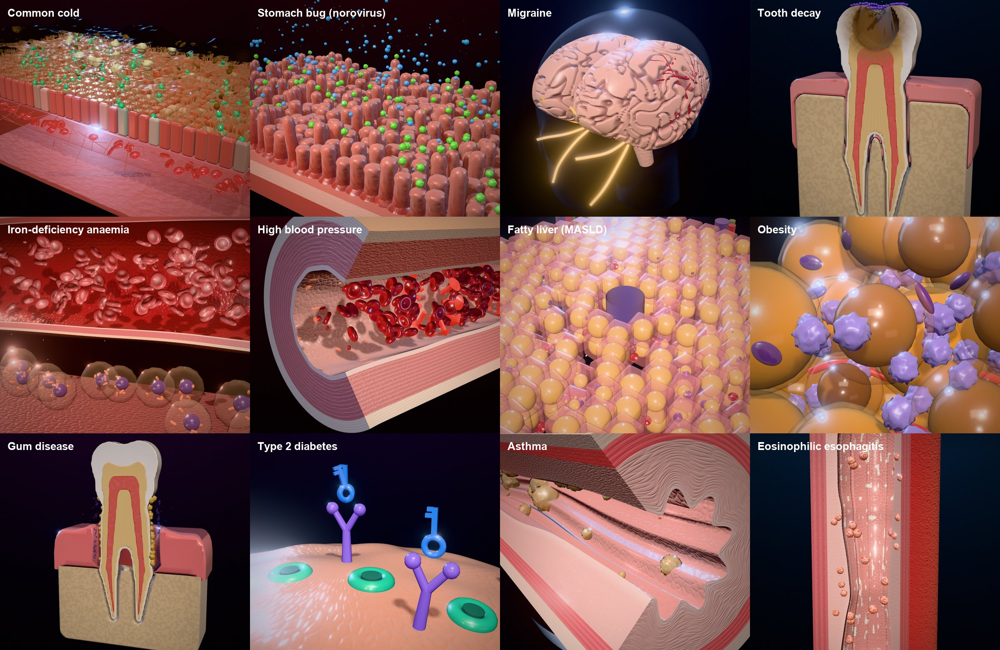

# Inside Illness

Interactive 3D simulations that show what happens inside the body during twelve common illnesses — built entirely in code with Three.js / WebGL (no 3D model files).

**Live demo:** https://diegocp01.github.io/inside-illness-3d/



- **Left panel (≈30%)**: pick an illness; it expands with a one-line explanation, a headline statistic, where it happens and key signs (tap *More* for tips and sources).
- **Right (≈70%)**: the 3D simulation. Drag to rotate, scroll/pinch to zoom, right-drag to pan.
  - **Healthy ⟷ Illness** switch and a progress slider morph the scene between a healthy body and the illness.
  - **Story** card walks through 5 short steps (camera moves and the illness progresses); press *Play* to autoplay.
  - A live **readout** (blood pressure, blood sugar, haemoglobin, pH, pocket depth…) tracks the progression.
  - Toggle labels (`L`), auto-rotate (`R`), step with `←/→`, switch illness with `↑/↓`, flip healthy/sick with `Space`.

## Run it

```bash
npm install
npm run dev
```

Then open the URL Vite prints (http://localhost:5173). `npm run build` writes a static site to `dist/`; every push to `main` redeploys it to GitHub Pages via `.github/workflows/deploy.yml`.

## The illnesses

Top ten (from `illnesses.md`, each narrowed to one specific condition — see `RESEARCH.md`): common cold (rhinovirus), norovirus stomach bug, migraine, tooth decay, iron-deficiency anaemia, primary hypertension, MASLD fatty liver, obesity, severe periodontitis, type 2 diabetes. Plus asthma and eosinophilic esophagitis.

## Code map

| Path | What it does |
|---|---|
| `src/main.js` | UI: sidebar list, story steps, controls, readout, URL hash routing |
| `src/data/illnesses.js` | All text, numbers, steps (with the illness level and camera view per step) and sources |
| `src/engine/stage.js` | Renderer, camera flights, lighting, reflection environments, bloom/vignette, 3D labels |
| `src/engine/tube.js` | GPU-shaped layered tubes (vessels, airways, esophagus) whose walls pulse, thicken or fold in the shader |
| `src/engine/shapes.js` | Signed-distance modelling + surface nets (tooth, liver, body), red cells, viruses, white cells |
| `src/engine/materials.js` | Procedural normal maps, wet-tissue and translucent-membrane materials, glowing particles |
| `src/scenes/*.js` | One file per illness; each returns `{ root, update(t, dt, sick), labels, views, env }` |

To add an illness: add an entry to `src/data/illnesses.js`, create `src/scenes/<id>.js` that returns the object above, and register it in `sceneLoaders` in `src/main.js`.

*For learning only — simplified illustrations, not medical advice.*
